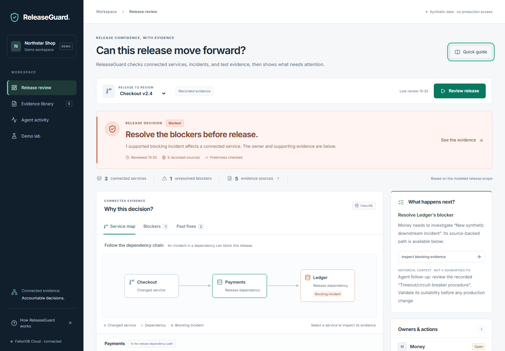

# ReleaseGuard

**October 17, 2026: working background investigations and redesigned release-review UI.** Gemini selects bounded history/source graph tools, persists findings for a separate verifier invocation, and passes deterministic evidence gates before the policy/action pipeline runs. The UI leads with the decision, connected evidence and next action. Graph-policy-only investigation remains available in Demo lab.

ReleaseGuard helps an engineering lead trace release risks across service dependencies, inspect sources and historical failed attempts, assign a blocker to the owning team, and detect when earlier recommendations become stale.

Open [the local app](http://127.0.0.1:8000), choose **Review release**, then inspect **Service map**, **Blockers** and **Past fixes**. **Quick guide** explains the workflow; **Technical details** contains calls and timings. [Submission copy, demo script and judge questions](docs/Submission-Readiness.md), [UI review and evidence](docs/UI-Redesign-Review.md).

Watch the [YouTube demonstration](https://youtu.be/qnejDVhVe-E), or the [included narrated MP4](demo/ReleaseGuard-demo.mp4), with [captions](demo/captions.srt) and [transcript/edit disclosures](demo/README.md). It shows real recorded execution using synthetic company data, with separate takes and shortened waiting time explicitly labeled.

**[Open the live shared demo](https://releaseguard-7hx8.onrender.com/).** It uses a separate synthetic FalkorDB Cloud graph and Gemini 3.7 Flash, with public editing disabled and shared bounded AI reviews. A real hosted review completed Blocked with four model calls, six tools and an accepted verifier result. Render Free may take about a minute to wake; provider free quota also limits new reviews. See [deployment evidence and limits](docs/Public-Deployment.md).



## Recommended queued runtime

For the hosted shared-demo configuration, see [public deployment](docs/Public-Deployment.md). It includes a Docker image, isolated synthetic graph, disabled public editing and a graph-persisted AI review limit.

Use the [durable investigation setup](docs/Durable-Investigations.md) for the API, Linux RQ worker, dispatcher and password-protected queue. Investigations return HTTP 202 and continue after page reload; progress and findings remain in FalkorDB. The same guide documents the tested recovery boundaries and measured results. Stop standalone API/writer processes before starting this runtime.

## Standalone core development

The commands below are for an isolated standalone development environment. They do not start the queue worker. Use container CLI commands from the queued-runtime guide when its API/worker are active, so Linux processes share one writer lock implementation.

From the repository root, start the graph using the existing [environment instructions](docs/Environment.md). The secret-free Compose template is `environment/compose.yaml`; password stays in ignored `.local/.env`.

```powershell
wsl -d Ubuntu -u root -- service docker start
wsl -d Ubuntu -u root -- docker compose --env-file /mnt/a/ReleaseGuard/.local/.env -f /mnt/a/ReleaseGuard/environment/compose.yaml up -d --wait
```

Python 3.12 is required. On a fresh machine, create a venv with your installed Python 3.12. The existing venv depends on Codex's bundled runtime and is not portable. For this workspace:

```powershell
.\.venv\Scripts\python.exe -m pip install -r requirements-lock.txt
.\.venv\Scripts\python.exe -m pip install -e . --no-deps
.\.venv\Scripts\python.exe -m releaseguard.cli seed
$env:RELEASEGUARD_DEMO = '1'
.\.venv\Scripts\python.exe -m uvicorn releaseguard.api:app --host 127.0.0.1 --port 8000
```

Open **http://127.0.0.1:8000**. Synthetic mutation controls are disabled unless RELEASEGUARD_DEMO=1. Keep this demo bound to localhost; it does not include user authentication or production access controls.

If `.local/.env` is missing, create `.local/falkordb-data`, generate a random hexadecimal password locally, and save `FALKORDB_PASSWORD=<generated-value>` in `.local/.env`. Never use the `.env.example` placeholder as a credential or commit the real file. Adjust WSL-mounted paths when cloning somewhere other than A:\ReleaseGuard.

## Model and cloud configuration status

The root ignored `.env` is loaded after `.local/.env`; process environment variables take precedence. Set `GEMINI_API_KEY` locally. Live Gemini Interactions requests succeeded with `gemini-3.8-flash`, including a request through the application adapter. The tool workflow is separately verified in the agent implementation report. The older `gemini-2.5-flash` endpoint rejected this account/model combination. Standalone generation retries transient failures at most twice; the worker permits bounded recovery of transient agent failures without resetting the five-call budget. Authentication and quota errors are not retried.

Cloud selection requires `FALKORDB_CLOUD_HOST` and `FALKORDB_CLOUD_PASSWORD`; `.env.example` documents the other settings. Match transport settings to the actual instance connection details. TLS certificate verification remains enabled whenever TLS is selected. To run the original local Compose database, set `FALKORDB_TARGET=local` in your process environment or ignored `.env`.

The user-created Free instance was authenticated, seeded with synthetic Northstar data, and verified through the running API. On October 17 its hostname temporarily failed DNS; after the instance was reported Healthy it resolved again, and the cloud-backed background workflow completed Ready. This workspace now selects cloud. Its endpoint speaks plaintext Redis; it is for synthetic evaluation data only. HA, backups and autoscaling are disabled in the dashboard. The dashboard subsequently confirmed Running/Healthy; cloud recovery remains unverified. The original local graph is preserved.

See [configuration evidence](outputs/configuration/Configuration-Status.md). Never commit real credentials.

## Working example

```powershell
.\.venv\Scripts\python.exe -m releaseguard.cli assess
.\.venv\Scripts\python.exe -m releaseguard.cli latest
```

A fresh synthetic fixture returns **Blocked**, with `checkout -> payments -> inc-12` and one Money-owned task. Repeated assessments do not duplicate that logical blocker. All source content and incident/test records are fictional. CLI assessments use new request IDs; API request keys permit explicit replay.

In the browser: investigate -> resolve Payments incident -> observe Needs reassessment -> investigate -> Ready -> create Ledger incident -> observe Needs reassessment -> investigate -> Blocked through Checkout/Payments/Ledger. Expire verification to demonstrate missing evidence. Passing verification is a synthetic record, not real CI execution.

An interrupted mutation disables fresh verdicts. Recover its persisted command with:

```powershell
.\.venv\Scripts\python.exe -m releaseguard.cli recover
```

Recovery supports journaled seed, task and supported synthetic-event operations; malformed/unknown operations fail closed. It does not provide distributed exactly-once guarantees.

## Gemini investigation

Click **Review release** for the queued agent workflow. In an isolated standalone development environment, use:

```powershell
.\.venv\Scripts\python.exe -m releaseguard.cli agent --request-key my-first-agent-run
.\.venv\Scripts\python.exe -m releaseguard.cli agent-latest
```

At most five model requests, ten tool calls and four investigator turns are admitted. The final investigator turn offers only findings submission. Each invocation has a 90-second admission deadline and each provider call a timeout; synchronous HTTP phase timeouts are not a hard process kill deadline. Context is capped at 25,000 serialized characters per invocation. No raw Cypher, shell, arbitrary graph selection or production deployment tool is exposed. Same request key replays a saved terminal run; use a new key to retry an incomplete run.

Model failures remain **Incomplete**, unsupported proposals **Rejected**, and changed evidence **Stale**, with agent actions withheld. Existing graph-policy results remain visibly separate. Explanations are rendered from verified IDs and source-backed historical records. A historically useful procedure requires current validation.

See [agent implementation and validation](docs/Gemini-Agent-Workflow.md). The queued runtime now provides durable dispatch and checkpoint recovery; see the [October 17 report](docs/Durable-Investigations.md). Single-host and failure-interleaving limitations remain explicit.

## Architecture and essential graph use

FastAPI routes call application services; domain policy is separate from Cypher. The official client executes bounded parameterized graph queries. Source-linked paths and historical attempts feed a deterministic assessment; a serialized action creates a task connected to its release, incident and owner. A stored domain revision and expiry are rechecked when reading recommendations.

See [implementation report](docs/First-Working-Core.md), [query examples](queries/dependencies.cypher), and [requirements](docs/ReleaseGuard-Requirements-Specification.md). The prototype stores canonical state in FalkorDB; it cannot return a fallback release decision if the graph is unavailable.

## Verify and compare

```powershell
.\.venv\Scripts\python.exe -m pytest -q
.\.venv\Scripts\python.exe -m ruff check backend
.\.venv\Scripts\python.exe -m pip check
.\.venv\Scripts\python.exe -m releaseguard.evaluation
```

Tests require local FalkorDB. They create and remove isolated `releaseguard_test_*` graphs; the comparison uses `releaseguard_eval_*`. They do not delete the Northstar demonstration graph. No mocked graph responses establish correctness.

**50 backend tests now pass**, including agent evidence gates, recovery boundaries, static assets and refusal to publish prose-only or truncated model output; see [current test evidence](outputs/ui-review/backend-tests.xml). Eleven browser interaction checks and selected automated accessibility scans cover the redesigned interface. The original 23-test core checkpoint and comparison agreed on all four relationship cases with a competent same-facts adjacency-list baseline. The in-memory baseline was faster on the small dataset; no accuracy or speedup advantage is claimed. [Actual results and raw samples](outputs/implementation/graph-comparison.json), [test evidence](outputs/implementation/test-results.xml), and [limitations](docs/First-Working-Core.md).

## Remaining work

Broader agent evaluation remains. The source is public and the narrated demo is available on YouTube and in `demo/`, with captions. The redesigned interface has desktop/mobile browser checks and source-inspection QA; see the UI review for their scope. Durable dispatch and checkpoint/assessment-commit recovery are implemented within the tested single-host boundary. Current tests establish database graph separation, not authenticated tenant isolation. Graceful container restart preserves tested assessments/tasks; disaster recovery is unverified. Four-hop/row/query-time bounds can require abstention.

Target tracks: Agents That Act on Connected Data (primary), Agent Memory and Coordination (secondary). AI assistance was used for planning, implementation, testing, documentation and synthesized demo narration; participants must review, test and explain the final system. The [official rules](https://www.wemakedevs.org/hackathons/falkordb/rules) govern submission. No public application deployment is claimed.
